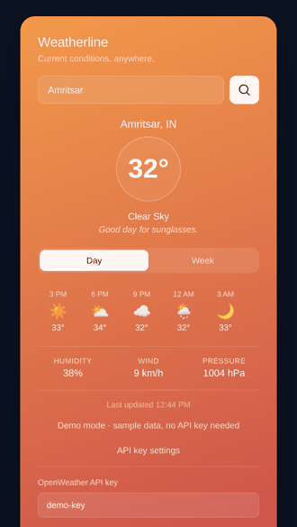
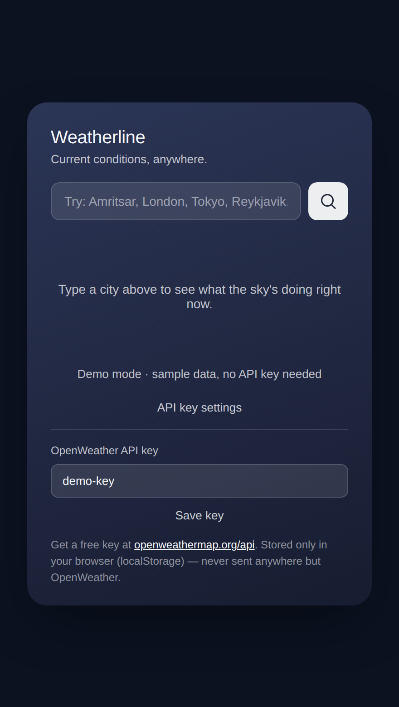
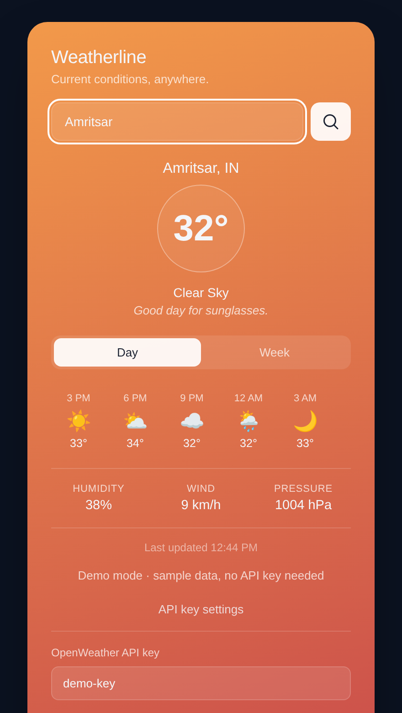
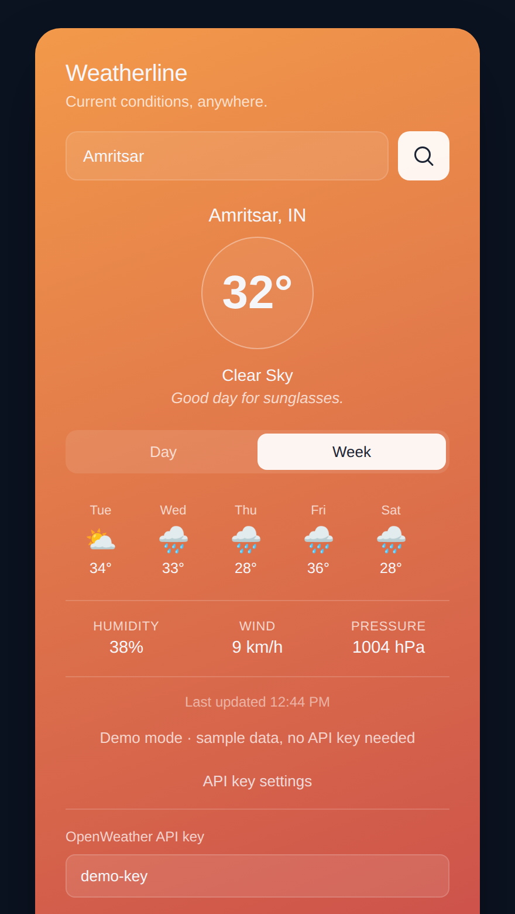
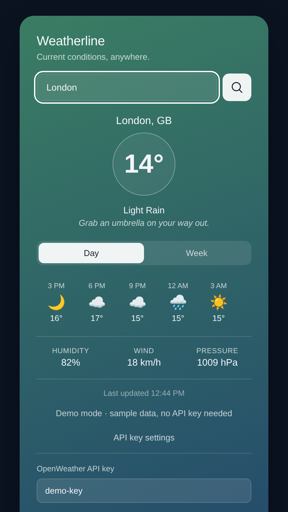
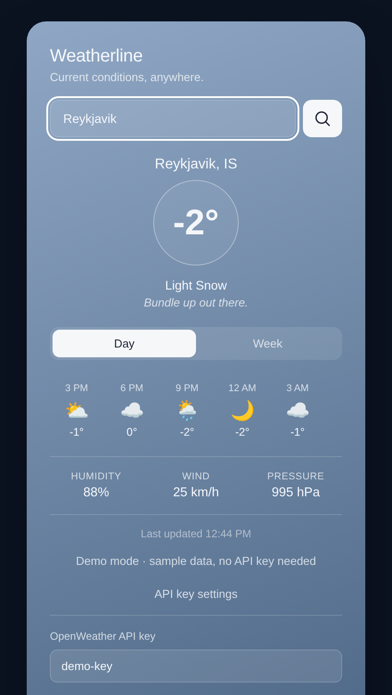
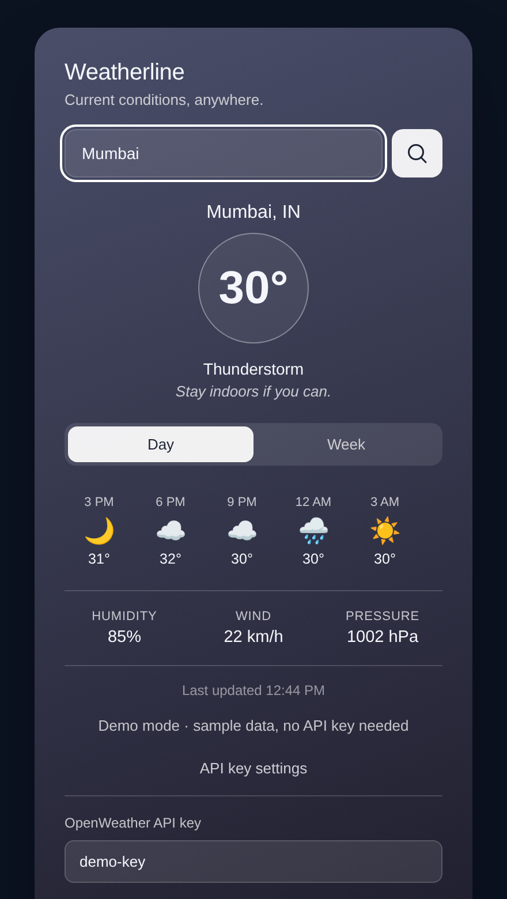
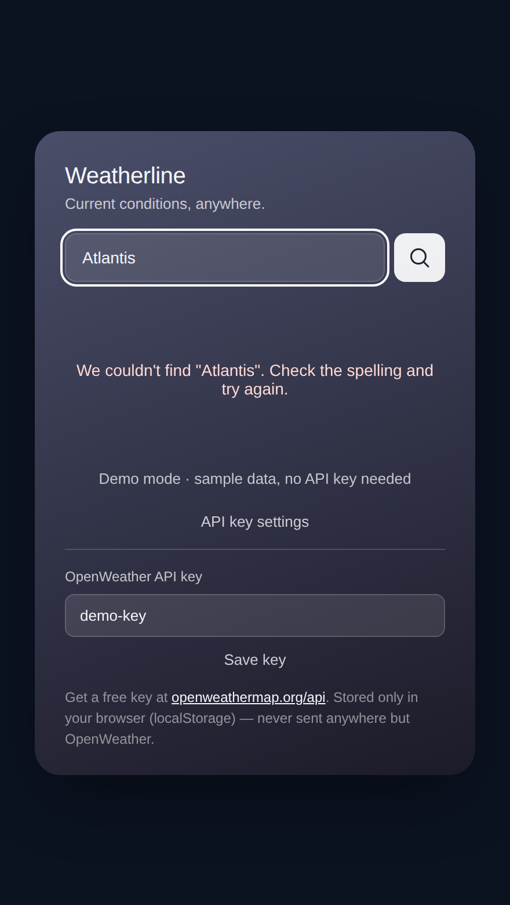

# ☁️ Weatherline

**A clean, single-card weather app.** Search any city and get current conditions, a day or week forecast, and a background that changes with the weather. Built with plain HTML, CSS and JavaScript on the [OpenWeather API](https://openweathermap.org/api). No frameworks, no build step.



> 🎬 \*\*Try it without an API key:\*\* open \[`demo.html`](demo.html). It runs the same app with sample data for Amritsar, London, Tokyo, Reykjavik and Mumbai.

\---

## ✨ Features

* 🔍 **City search** for any city worldwide, with friendly errors for unknown cities, bad keys and network failures
* 🌡️ **Live conditions**: temperature (°C), weather description, humidity, wind (km/h) and pressure (hPa)
* 🕒 **Day view**: the next 24 hours in 3-hour steps
* 📅 **Week view**: the next 5 days, using the midday reading for each date
* 🎨 **Mood theming**: the card gradient and a short caption change for clear day/night, clouds, rain, thunderstorm, snow and mist
* 🔑 **Bring your own key**: paste your free OpenWeather key in the app; it is stored only in your browser's `localStorage`
* ♿ **Accessible and responsive**: labelled inputs, ARIA tab roles, visible focus states, mobile-friendly layout

## 📸 Screenshots

|Idle|Clear day|Week forecast|
|:-:|:-:|:-:|
|  |||

|Rain|Snow|Thunderstorm|Error|
|:-:|:-:|:-:|:-:|
|||||

## 🚀 Getting started

1. **Get a free API key** at [openweathermap.org/api](https://openweathermap.org/api). New keys can take a few minutes to activate.
2. **Clone the repo**

```bash
   git clone https://github.com/<your-username>/WD\_4\_WeatherApp\_BYTE.git
   cd WD\_4\_WeatherApp\_BYTE
   ```

3. **Open `index.html`** in your browser. You can also serve it locally:

```bash
   python3 -m http.server 8000   # then visit http://localhost:8000
   ```

4. Click **API key settings**, paste your key, press **Save key**, then search a city.

## 🗂️ Project structure

```
WD\_4\_WeatherApp\_BYTE/
├── index.html   # Markup: search, states (idle/loading/error/result), forecast, key panel
├── style.css    # Layout, mood gradients, responsive rules
├── script.js    # API calls, state handling, rendering, key storage
├── demo.html    # Self-contained demo with mock data (no key needed)
└── media/       # Screenshots and demo GIF
```

## 🔧 How it works

1. `GET /data/2.5/weather?q={city}\&units=metric` returns the current conditions.
2. The returned coordinates feed `GET /data/2.5/forecast?lat=\&lon=` (5-day / 3-hour forecast) so both requests refer to the same place.
3. `moodFromWeather()` maps the condition group and day/night icon to a mood key, which sets `data-mood` on the card so CSS swaps the gradient.
4. The Day/Week toggle re-renders from the cached forecast, with no extra API call.

|Status|Behaviour|
|-|-|
|`404`|"We couldn't find *city*" message|
|`401`|Key rejected, key panel opens|
|Other / offline|Generic retry message|

## 🛠️ Built with

HTML5 · CSS3 (custom properties, grid, flexbox) · Vanilla JavaScript (`fetch`, async/await, `localStorage`) · OpenWeather API · Google Fonts (Space Grotesk, Inter)

## 🔭 Ideas for next steps

* Use the browser's geolocation for a "my location" button
* °C / °F toggle
* Remember recent searches
* Proxy the API through a small backend so the key isn't exposed client-side

## 👤 Author

Made by **SM01010011** for the BYTE Web Development project (WD-4).


